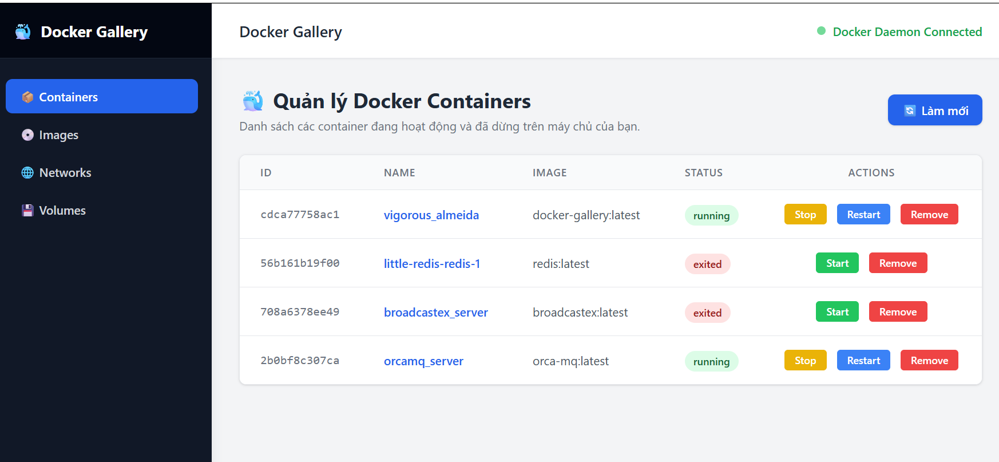

# Docker Gallery

A lightweight, modern, and self-hosted Docker management dashboard built with **FastAPI**, **HTMX**, **Alpine.js**, and **Tailwind CSS**.



## Tech Stack
- Backend: Python, FastAPI, Uvicorn, Docker Python SDK

- Frontend: Tailwind CSS (CDN), HTMX, Alpine.js, Chart.js


## Key Features

- **Containers Management:** List, start, stop, restart, remove containers, and inspect their configurations.
- **Real-time Logs:** Stream container logs directly via WebSockets.
- **Resource Observability:** Monitor real-time **CPU** and **Memory** usage percentages with live charts (powered by Chart.js & WebSockets).
- **Images Management:** List, pull new images from registries, and remove images.
- **Volumes Management:** List, inspect, and remove Docker volumes.
- **Network Inspector:** List Docker networks, see connected containers and their IP addresses, and inspect network configuration.
- **Modern UI:** Inspired by Docker Desktop, featuring a sleek Tailwind CSS layout combined with HTMX for fast, seamless page updates without full reloads.

---

## Build and Run with Docker

The app connects to the Docker daemon through its Unix socket. On Linux, build and run it from the project root:

```bash
docker build -t docker-gallery .
docker run --rm -p 8000:8000 \
  -v /var/run/docker.sock:/var/run/docker.sock \
  docker-gallery
```

Open [http://localhost:8000](http://localhost:8000). Press `Ctrl+C` to stop the container.

For Docker Desktop with WSL integration, if the active Docker context uses `/mnt/wsl/shared-docker/docker.sock`, mount that socket instead:

```bash
docker run --rm -p 8000:8000 \
  -v /mnt/wsl/shared-docker/docker.sock:/var/run/docker.sock \
  docker-gallery
```

Mounting the Docker socket gives the app control over the host Docker daemon, effectively granting root-level access to the host. Only run this dashboard in a trusted environment. If your Docker context uses another Unix socket, mount that socket at `/var/run/docker.sock` inside the container.

To run locally without Docker, install `requirements.txt` and start the app with:

```bash
uvicorn app.main:app --reload
```

## API Documentation

Swagger at `/docs` lists the JSON API endpoints only. HTML pages, HTMX fragments/actions, and WebSocket routes are not included in the OpenAPI schema.
